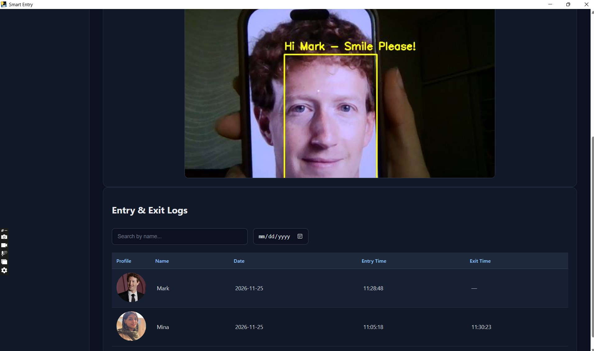
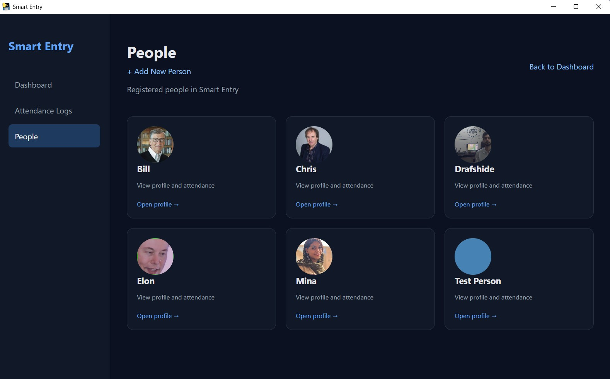
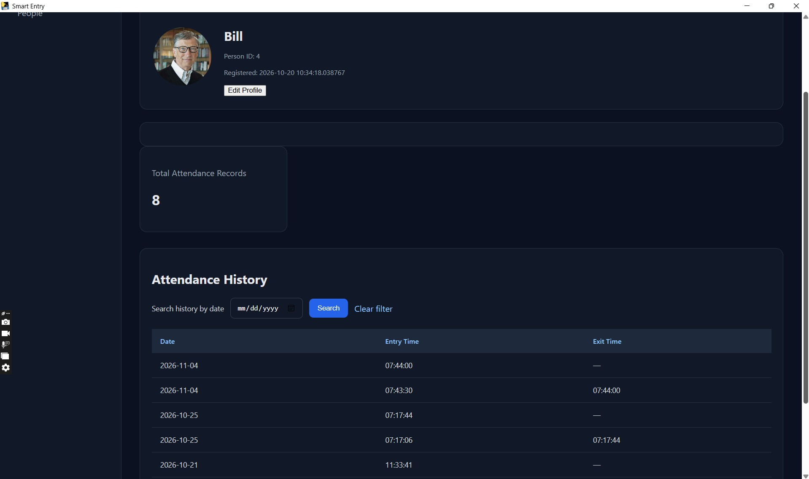
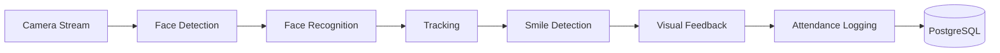

# Smart Entry — Face Recognition & Attendance System

Smart Entry is a real-time computer vision system that recognizes people on camera,
detects their smile, and logs their attendance. It ships with a web-based admin
dashboard for managing people, profile photos, and attendance history, plus a
Windows desktop app and installer.

## Features

- Real-time face detection, tracking, and recognition (InsightFace, 512-d embeddings)
- Smile detection with "Welcome!" / "Smile Please!" on-screen feedback
- Automatic entry/exit logging with per-day attendance history
- People management with profile photos through an admin dashboard
- Live camera monitoring directly in the dashboard
- Works with a local webcam or an RTSP network camera
- Periodic embedding reload — people enrolled from the web panel are recognized
  without restarting the recognition process
- PostgreSQL + pgvector storage for face embeddings and attendance records
- Windows packaging: single-EXE desktop app, server/admin split, and an installer

## Screenshots

### Dashboard & Live Recognition



### People Management



### Person Profile & Attendance History



## How It Works



- The recognition process opens the camera and serves an annotated MJPEG stream
  on `127.0.0.1:8091`; the web dashboard proxies it, so the camera is opened only
  once and the live view shows the same annotated frames the system sees.
- When no RTSP URL is configured, the local webcam (index 0) is used.

## Tech Stack

Python 3.10 · OpenCV · InsightFace · ONNX Runtime · MediaPipe · FastAPI · Uvicorn ·
Jinja2 · Peewee · PostgreSQL + pgvector · HTML/CSS/JavaScript · PyInstaller · Inno Setup

## Prerequisites

- Python 3.10 (64-bit)
- PostgreSQL with the `pgvector` extension
  - Install pgvector, then run once: `CREATE EXTENSION vector;` (the app also
    runs this automatically when it can)
- A camera: local webcam, or an RTSP network camera
- Windows (for the packaged EXEs and installer)

## Setup (Development)

```bash
# 1. Create and activate a virtual environment
python -m venv venv
venv\Scripts\activate          # Windows

# 2. Install dependencies
pip install -r requirements.txt

# 3. Create the configuration file (see Configuration below)
copy smart-entry.example.env smart-entry.env

# 4. Create the database tables
python Face-Recognition/model.py
```

> The bundled DaSiamRPN tracker models (`Face-Recognition/tracker_models/`) are
> not included in this repository. Download them once into that folder:
> [dasiamrpn_model.onnx](https://www.dropbox.com/s/rr1lk9355vzolqv/dasiamrpn_model.onnx?dl=1),
> [dasiamrpn_kernel_r1.onnx](https://www.dropbox.com/s/999cqx5zrfi7w4p/dasiamrpn_kernel_r1.onnx?dl=1),
> [dasiamrpn_kernel_cls1.onnx](https://www.dropbox.com/s/qvmtszx5h339a0w/dasiamrpn_kernel_cls1.onnx?dl=1).
> InsightFace downloads its own models automatically on first run.

## Configuration

`smart-entry.env` (in the project root, or `C:\ProgramData\SmartEntry` for the
installed app):

| Key | Description |
|---|---|
| `SMART_ENTRY_DB_NAME` | PostgreSQL database name |
| `SMART_ENTRY_DB_USER` | Database user |
| `SMART_ENTRY_DB_PASSWORD` | Database password |
| `SMART_ENTRY_DB_HOST` | Database host (e.g. `localhost`) |
| `SMART_ENTRY_DB_PORT` | Database port (usually `5432`) |
| `SMART_ENTRY_RTSP_URL` | RTSP camera URL — **leave empty to use the local webcam** |

## Running (Development)

```bash
# Web dashboard + recognition together
python server_main.py
# Dashboard: http://127.0.0.1:8002

# Standalone recognition window (webcam or RTSP)
python Face-Recognition/Face-Emotion-Recog.py
```

`server_main.py` starts the FastAPI dashboard on port `8002` and the recognition
process in the background.

## Windows Builds

| EXE | Description |
|---|---|
| `SmartEntry.exe` | All-in-one: server + recognition + desktop admin window |
| `SmartEntryServer.exe` | Headless server + recognition (network admin at `http://<server-ip>:8002`) |
| `SmartEntryAdmin.exe` | Desktop window that opens the admin dashboard |
| `SmartEntrySetup.exe` | Inno Setup installer (choose "Server" or "Admin / Client" role) |

Build them with the specs in the repo root:

```bash
pyinstaller --noconfirm SmartEntry.spec
pyinstaller --noconfirm SmartEntryServer.spec
pyinstaller --noconfirm SmartEntryAdmin.spec
iscc SmartEntrySetup.iss        # requires Inno Setup
```

When packaged, persistent data (database config, InsightFace and tracker models,
profile photos, logs) lives in `C:\ProgramData\SmartEntry`.

## Project Structure

```
Smart-Entry/
├── Web-UI/                    # FastAPI admin dashboard
│   ├── app.py                 # routes: dashboard, people, profiles, uploads
│   ├── templates/             # Jinja2 pages
│   └── static/                # CSS / JS / default avatar
├── Face-Recognition/
│   ├── Face-Emotion-Recog.py  # main recognition + emotion + MJPEG stream
│   ├── Emotion_Detection.py   # MediaPipe smile detector
│   ├── model.py               # Peewee models + config loading
│   └── tracker_models/        # DaSiamRPN ONNX models (download separately)
├── Emotion-Detection/         # standalone emotion experiment
├── Smile-Detection/           # standalone smile experiment
├── server_main.py             # dev entry: dashboard + recognition
├── main.py                    # all-in-one EXE entry (adds desktop window)
├── admin_main.py              # admin window EXE entry
├── launcher.py                # EXE launcher helper
├── SmartEntry*.spec           # PyInstaller specs
└── SmartEntrySetup.iss        # Inno Setup installer script
```

## Troubleshooting

- **Dashboard live view is offline** — the recognition process must be running
  (it owns the camera). Refresh the page a few seconds after starting the app.
- **Recognition process exits** — check `smart-entry.env` and that PostgreSQL
  is running; the terminal log shows the reason.
- **`AttributeError: 'FaceAnalysis' object has no attribute 'rec_model'`** —
  update `insightface` (this project uses the 2.x API).
- **Tracker error about `dasiamrpn_model.onnx`** — download the tracker models
  into `Face-Recognition/tracker_models/` (see Setup).

## Author

**Mina Gh.** · [GitHub](https://github.com/mina91gh)
